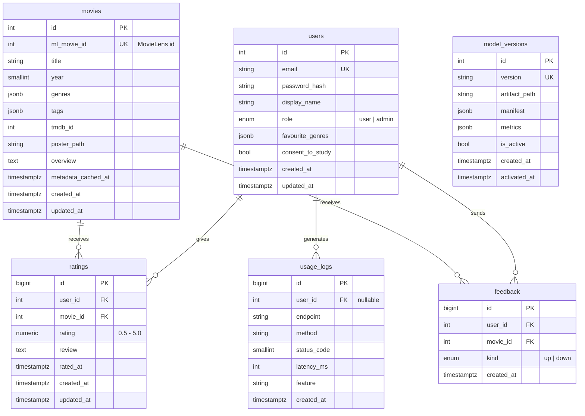

# Database design

PostgreSQL 16 is the system of record for the online application. The schema is
defined once in SQLAlchemy (`backend/app/models/`) and created through Alembic.

## Entity-relationship diagram



## Tables

| Table | Store | Purpose |
|---|---|---|
| `users` | D1 | Accounts, roles, favourite genres, study consent |
| `movies` | D2 | Catalogue metadata, content features, cached TMDB display data |
| `ratings` | D3 | One half-star rating per user/movie, plus optional review |
| `feedback` | D3 | Thumbs up/down events used by the session re-ranker and retraining |
| `model_versions` | D4 | Versioned artifacts with manifest, metrics and activation flag |
| `usage_logs` | D5 | Per-request endpoint, latency and status for the admin dashboard |

`model_versions` has no foreign keys: a model is trained on the dataset, not on one
user, and must survive account deletion.

## Design rules

- **Half-star ratings.** `ratings.rating` is `NUMERIC(2,1)` with a check constraint
  for `0.5 <= rating <= 5.0`, matching the UI and the MovieLens half-star scale.
- **One rating per pair.** `uq_ratings_user_movie` prevents duplicates; edits update
  the existing row so `rated_at` can drive the temporal split.
- **Cascades.** Deleting an account removes its ratings and feedback. Deleting a movie
  does too. `usage_logs.user_id` is `SET NULL` so aggregate analytics survive.
- **One active model.** A partial unique index (`WHERE is_active`) allows any number
  of registry rows but at most one active version, so activation and rollback are a
  single flag flip inside a transaction.
- **Timestamps.** `created_at`/`updated_at` are server-side; `rated_at` is when the
  viewer rated the film and is what the per-user temporal split uses.
- **Catalogue identity.** `movies.id` is a surrogate key; `movies.ml_movie_id` carries
  the MovieLens id so offline model artifacts join cleanly to API results.
- **Portable tests.** JSONB falls back to JSON and BIGSERIAL to INTEGER on SQLite
  (`backend/app/db/types.py`), so the schema and importer are tested without a
  PostgreSQL server. Production always runs PostgreSQL.

## Offline and online data are separate

```
data/processed/ml-25m-subset/*.csv ──► training pipeline ──► joblib + manifest
                                              │
                                              ▼
                                     model_versions (D4)
                                              │
users ──ratings/feedback──► PostgreSQL ──► inference ──► recommendations
```

The `ratings` table stores what **CineMatch accounts** rate in the app. The 1.48M
MovieLens ratings stay in the dataset files and are used only to train the
artifacts. Importing MovieLens users as fake accounts would blur real and
simulated feedback, pollute the user study and create delete/consent problems
later, so `scripts/import_movielens.py` imports the catalogue only.

## Migrations

```bash
cd backend
alembic upgrade head          # apply
alembic downgrade base        # drop everything (dev only)
alembic upgrade head --sql    # print the PostgreSQL DDL without connecting
```

Migrations read `DATABASE_URL` through `app.core.config`, so the same command works
locally and in Docker. The initial migration is
[`backend/alembic/versions/0001_initial_schema.py`](../backend/alembic/versions/0001_initial_schema.py).

## Importing the catalogue

```bash
# PostgreSQL (after `alembic upgrade head`)
python scripts/import_movielens.py data/processed/ml-25m-subset

# SQLite smoke test, no server needed
python scripts/import_movielens.py data/processed/ml-25m-subset \
  --database-url sqlite:///data/processed/cinematch-dev.sqlite --create-tables
```

The importer is idempotent (matched on `ml_movie_id`), never deletes catalogue rows,
and is safe to re-run after refreshing the subset.

### Verified import

Run on 2026-11-26 against PostgreSQL 16 (fresh database, migration applied with
Alembic) and repeated against a SQLite smoke-test database:

| Check | Result |
|---|---|
| Movies imported | 8,737 |
| Second run | 0 created, 8,737 updated |
| Movies with tags | 5,323 |
| Movies with a TMDB id | 8,734 |
| Movies without a parsed year | 13 |
| Spot check (`ml_movie_id = 1`) | `Toy Story (1995)`, genres stored as JSONB, TMDB `862` |
| JSONB containment (`genres @> '["Animation"]'`) | 418 movies |
| `uq_model_versions_one_active` | present and enforced (`WHERE is_active`) |
| Rating check constraint | rejects 6.0 |
| `alembic downgrade base` → `upgrade head` | drops all six tables and both enums, then recreates them |

The same checks run in CI: the backend job starts a PostgreSQL 16 service
container, applies the migration and runs `backend/tests/test_postgres.py`.
`docker compose` itself is still unverified locally because the Docker daemon
needs WSL2 (see [ADR-003](decisions.md)).

