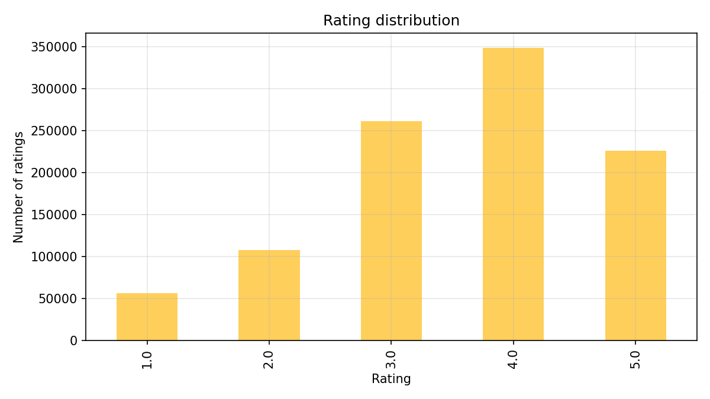
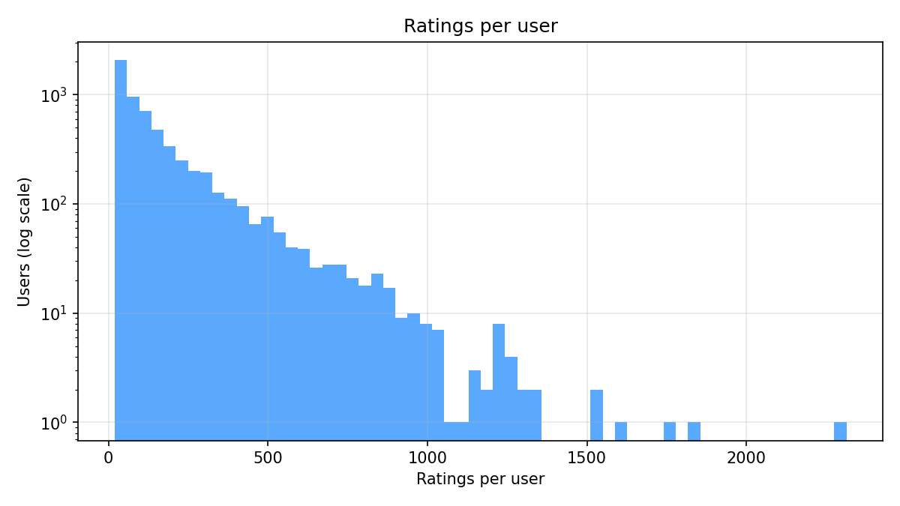
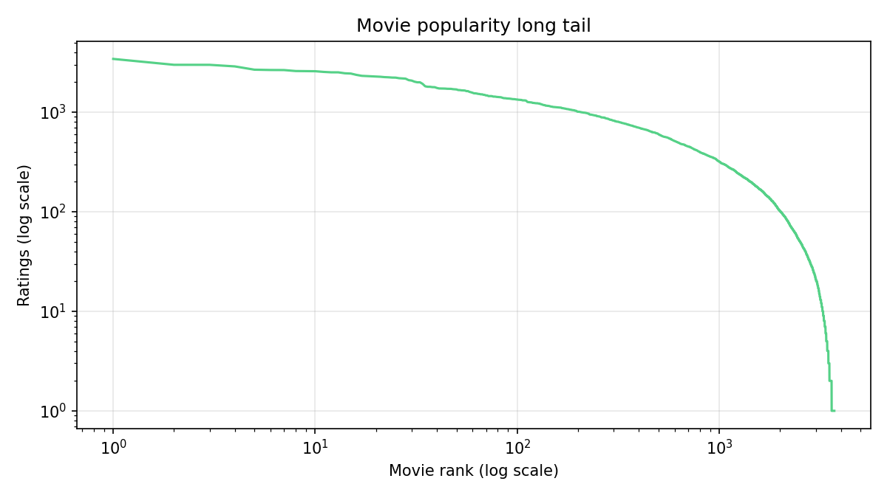
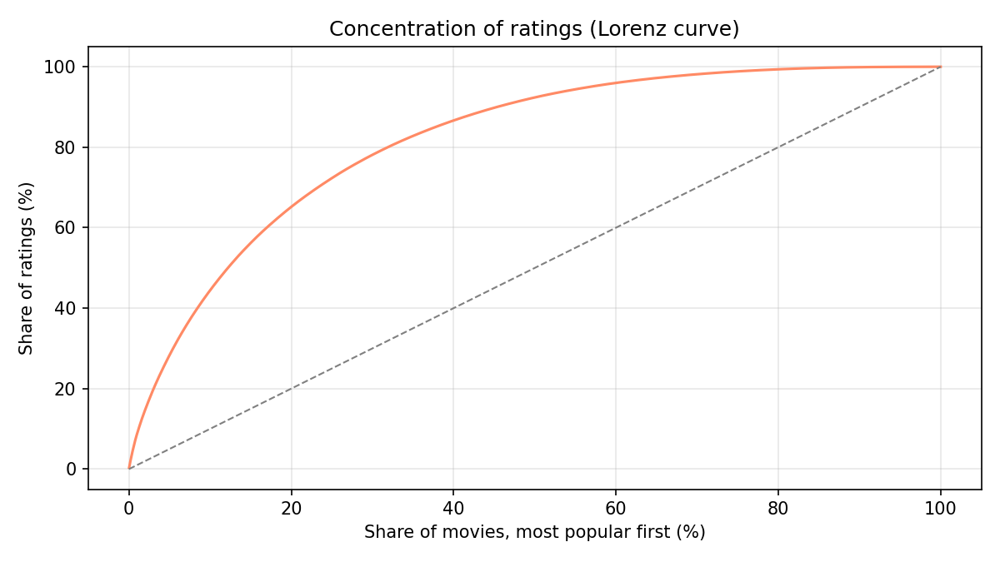
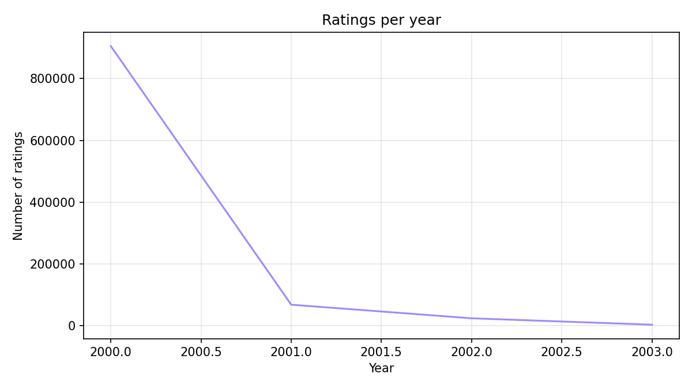
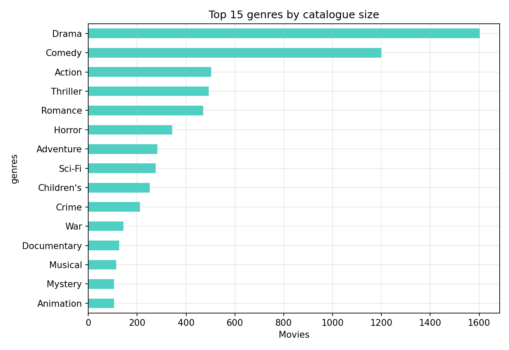

# EDA: ml-1m

_Generated 2026-11-25 04:20 UTC by `python -m ml.eda`._

## Headline counts

| Metric | Value |
|---|---|
| Ratings | 1,000,209 |
| Users | 6,040 |
| Movies in catalogue | 3,883 |
| Movies with at least one rating | 3,706 |
| Sparsity | 0.9553 |

## Rating distribution

| Metric | Value |
|---|---|
| Min / max | 1.0 / 5.0 |
| Mean | 3.5816 |
| Standard deviation | 1.1171 |

## Activity

| Metric | Value |
|---|---|
| Median ratings per user | 96.0 |
| p90 / p99 ratings per user | 400.0 / 906.7 |
| Max ratings by one user | 2,314 |
| Users with <= 20 ratings | 86 (1.4%) |
| Median ratings per movie | 123.5 |
| p90 / p99 ratings per movie | 729.5 / 1784.9 |
| Max ratings for one movie | 3,428 |
| Movie years | 1919 – 2000 |
| Rating years | 2000 – 2003 |

## Long tail

| Popular-movie group | Share of all ratings |
|---|---|
| Top 1% of rated movies | 8.7% |
| Top 5% of rated movies | 28.3% |
| Top 10% of rated movies | 44.5% |
| Top 50% of rated movies | 92.4% |

Gini coefficient of movie popularity: **0.634** (0 = perfectly even, 1 = all ratings on one movie).

## Tags and genres

| Metric | Value |
|---|---|
| Tags | 0 |
| Distinct tags | 0 |
| Movies with tags | 0 (0.0%) |
| Median tags per tagged movie | 0.0 |
| Tag-genome tags | 0 |
| Distinct genres | 18 |

## Figures

### Rating distribution

### Ratings per user

### Movie popularity long tail

### Rating concentration (Lorenz curve)

### Ratings per year

### Most common genres

