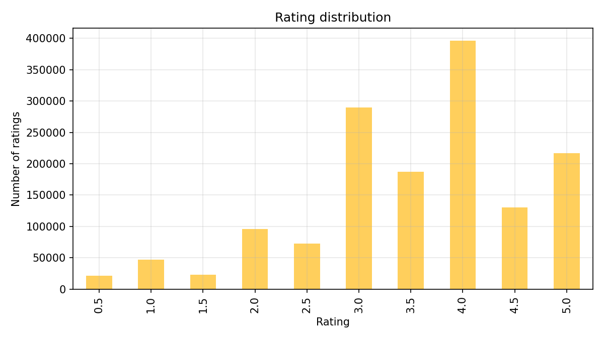
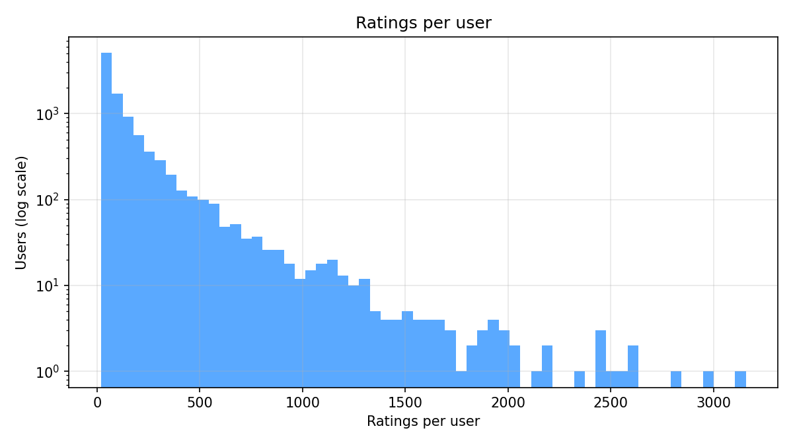
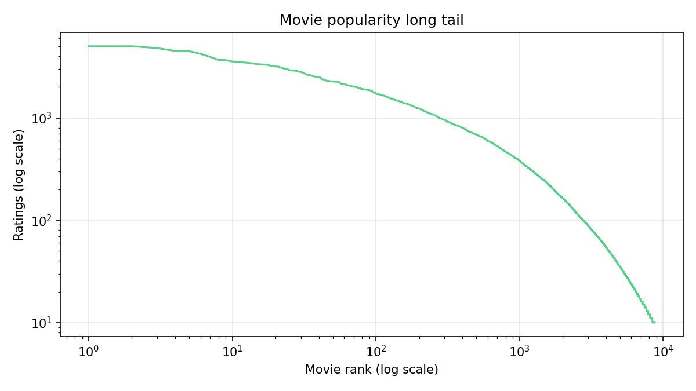
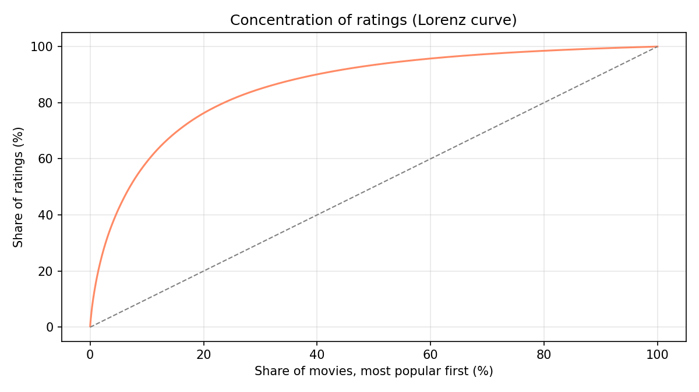
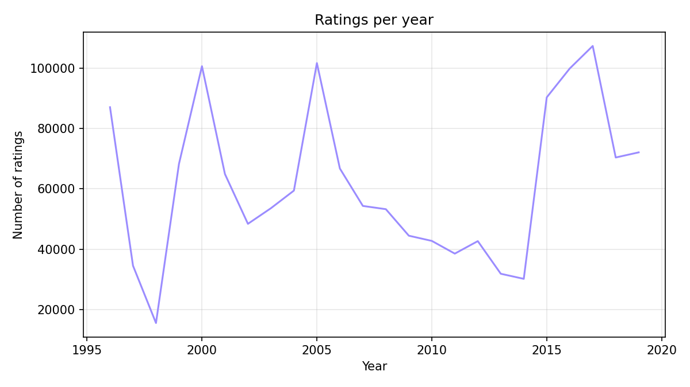
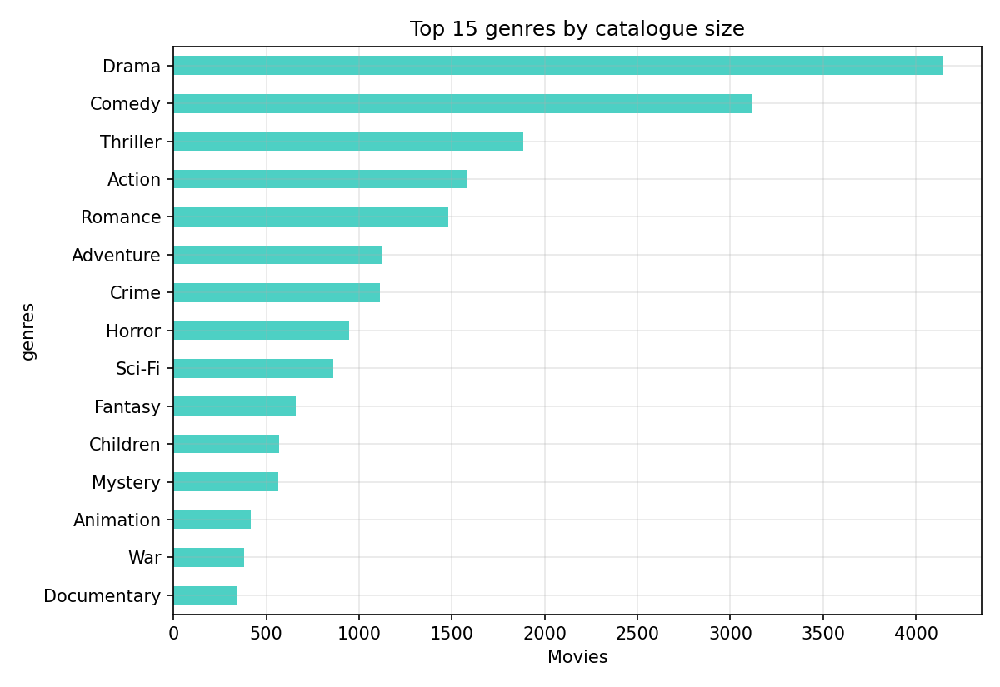

# EDA: ml-25m-subset

_Generated 2026-11-25 04:26 UTC by `python -m ml.eda`._

## Headline counts

| Metric | Value |
|---|---|
| Ratings | 1,478,848 |
| Users | 9,960 |
| Movies in catalogue | 8,737 |
| Movies with at least one rating | 8,737 |
| Sparsity | 0.9830 |

## Rating distribution

| Metric | Value |
|---|---|
| Min / max | 0.5 / 5.0 |
| Mean | 3.5453 |
| Standard deviation | 1.0561 |

## Activity

| Metric | Value |
|---|---|
| Median ratings per user | 70.0 |
| p90 / p99 ratings per user | 339.0 / 1150.9 |
| Max ratings by one user | 3,157 |
| Users with <= 20 ratings | 258 (2.6%) |
| Median ratings per movie | 46.0 |
| p90 / p99 ratings per movie | 433.0 / 1873.6 |
| Max ratings for one movie | 5,015 |
| Movie years | 1902 – 2019 |
| Rating years | 1996 – 2019 |

## Long tail

| Popular-movie group | Share of all ratings |
|---|---|
| Top 1% of rated movies | 15.6% |
| Top 5% of rated movies | 42.1% |
| Top 10% of rated movies | 58.9% |
| Top 50% of rated movies | 93.5% |

Gini coefficient of movie popularity: **0.712** (0 = perfectly even, 1 = all ratings on one movie).

## Tags and genres

| Metric | Value |
|---|---|
| Tags | 60,237 |
| Distinct tags | 12,016 |
| Movies with tags | 5,323 (60.9%) |
| Median tags per tagged movie | 5.0 |
| Tag-genome tags | 1,128 |
| Distinct genres | 19 |

## Figures

### Rating distribution

### Ratings per user

### Movie popularity long tail

### Rating concentration (Lorenz curve)

### Ratings per year

### Most common genres

