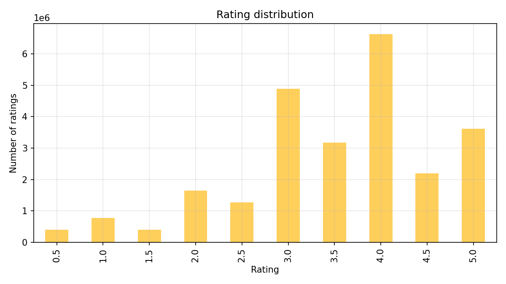
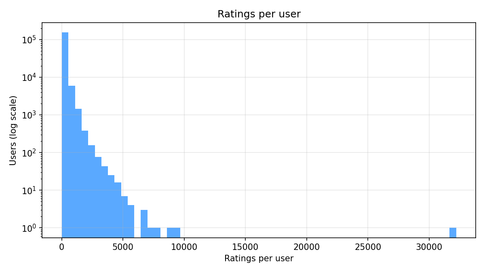
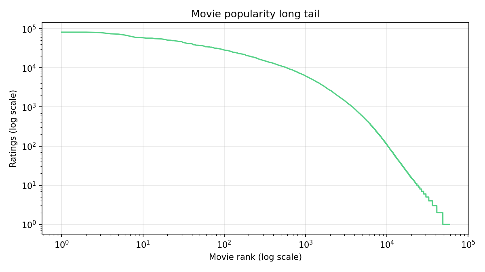
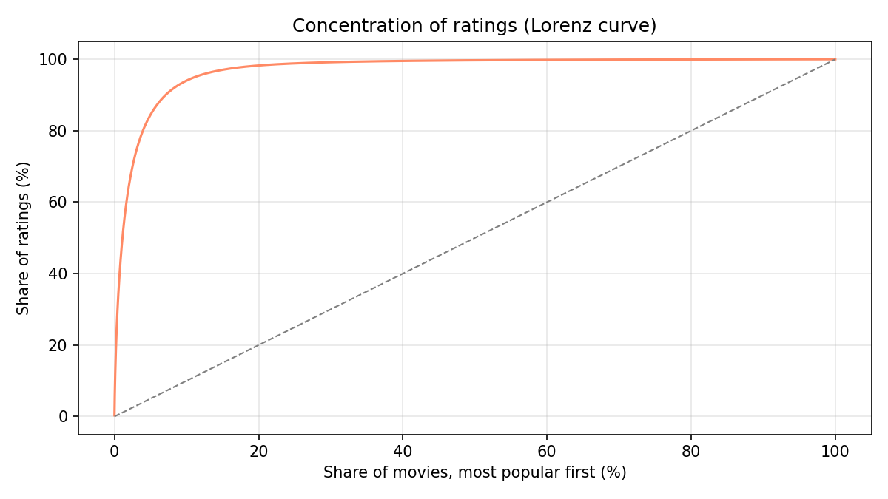
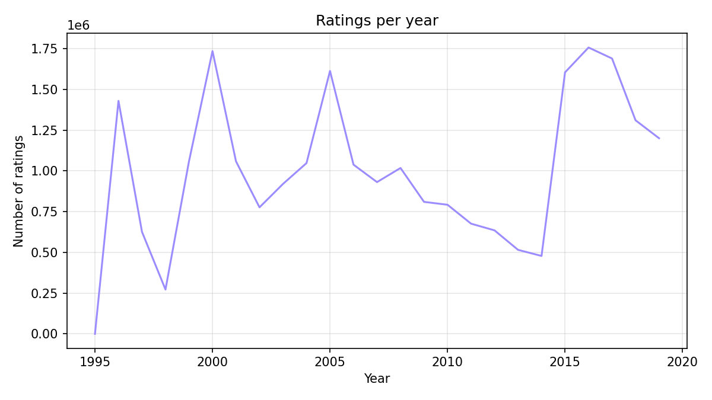
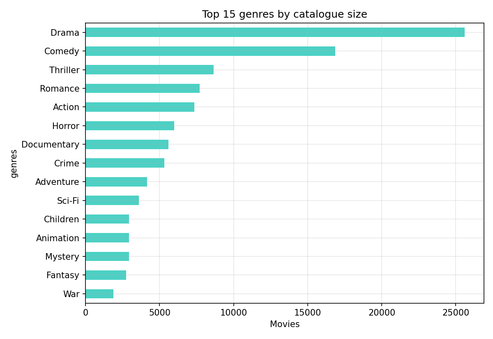

# EDA: ml-25m

_Generated 2026-11-25 04:21 UTC by `python -m ml.eda`._

## Headline counts

| Metric | Value |
|---|---|
| Ratings | 25,000,095 |
| Users | 162,541 |
| Movies in catalogue | 62,423 |
| Movies with at least one rating | 59,047 |
| Sparsity | 0.9974 |

## Rating distribution

| Metric | Value |
|---|---|
| Min / max | 0.5 / 5.0 |
| Mean | 3.5339 |
| Standard deviation | 1.0607 |

## Activity

| Metric | Value |
|---|---|
| Median ratings per user | 71.0 |
| p90 / p99 ratings per user | 353.0 / 1228.0 |
| Max ratings by one user | 32,202 |
| Users with <= 20 ratings | 4,611 (2.8%) |
| Median ratings per movie | 6.0 |
| p90 / p99 ratings per movie | 413.0 / 9941.6 |
| Max ratings for one movie | 81,491 |
| Movie years | 1874 – 2019 |
| Rating years | 1995 – 2019 |

## Long tail

| Popular-movie group | Share of all ratings |
|---|---|
| Top 1% of rated movies | 47.6% |
| Top 5% of rated movies | 84.5% |
| Top 10% of rated movies | 94.0% |
| Top 50% of rated movies | 99.7% |

Gini coefficient of movie popularity: **0.942** (0 = perfectly even, 1 = all ratings on one movie).

## Tags and genres

| Metric | Value |
|---|---|
| Tags | 1,093,360 |
| Distinct tags | 73,050 |
| Movies with tags | 45,251 (72.5%) |
| Median tags per tagged movie | 5.0 |
| Tag-genome tags | 1,128 |
| Distinct genres | 19 |

## Figures

### Rating distribution

### Ratings per user

### Movie popularity long tail

### Rating concentration (Lorenz curve)

### Ratings per year

### Most common genres

