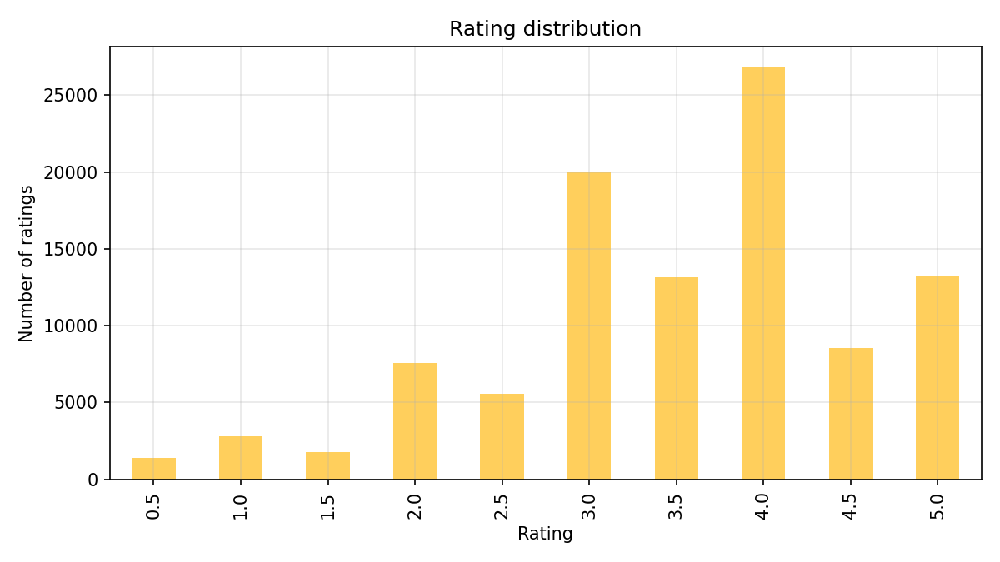
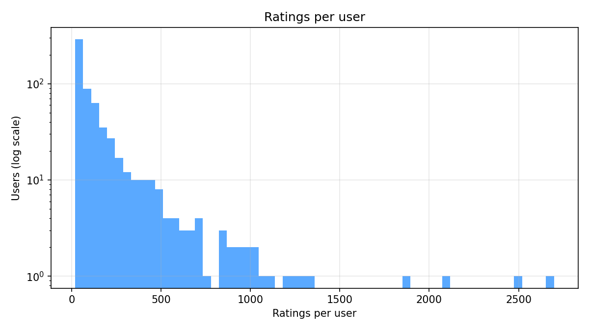
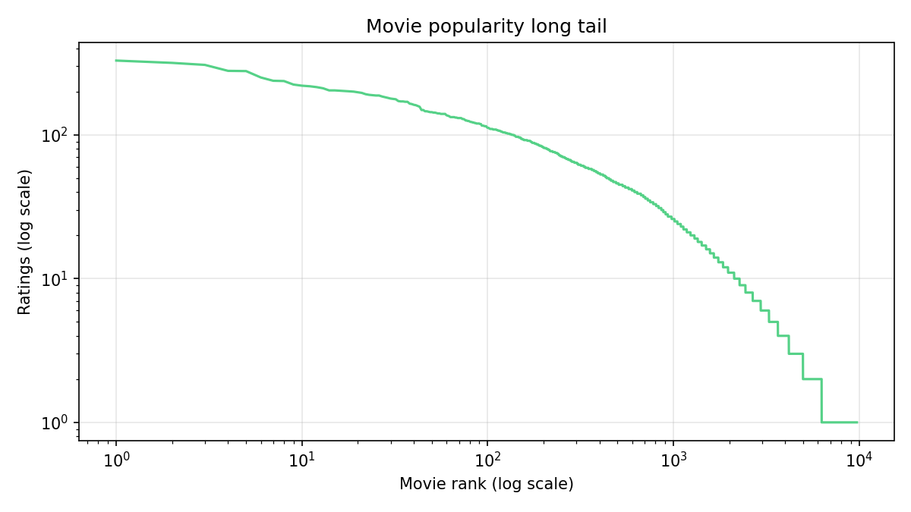
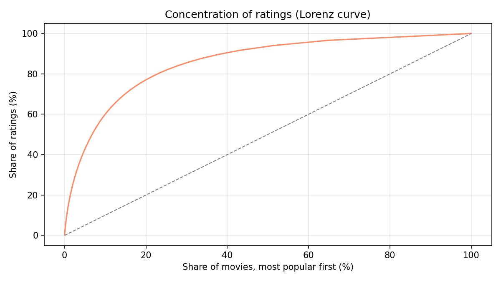
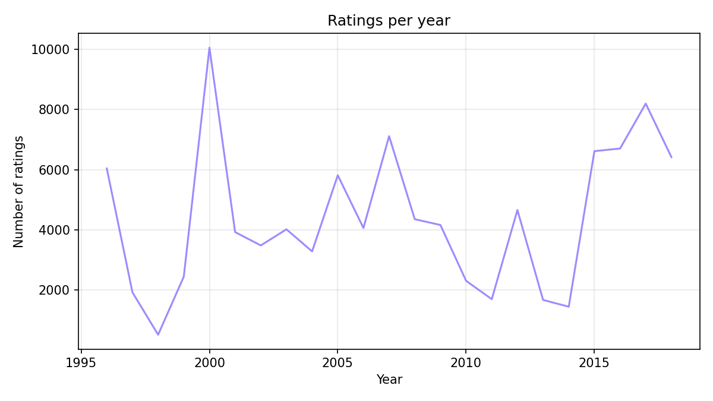
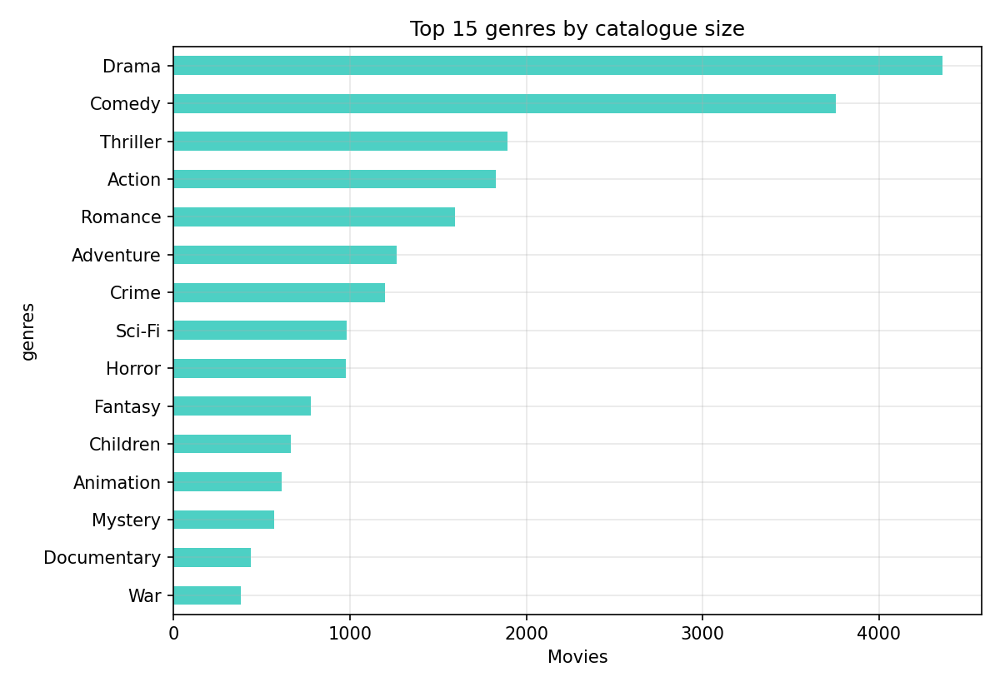

# EDA: ml-latest-small

_Generated 2026-11-25 04:20 UTC by `python -m ml.eda`._

## Headline counts

| Metric | Value |
|---|---|
| Ratings | 100,836 |
| Users | 610 |
| Movies in catalogue | 9,742 |
| Movies with at least one rating | 9,724 |
| Sparsity | 0.9830 |

## Rating distribution

| Metric | Value |
|---|---|
| Min / max | 0.5 / 5.0 |
| Mean | 3.5016 |
| Standard deviation | 1.0425 |

## Activity

| Metric | Value |
|---|---|
| Median ratings per user | 70.5 |
| p90 / p99 ratings per user | 400.3 / 1256.2 |
| Max ratings by one user | 2,698 |
| Users with <= 20 ratings | 14 (2.3%) |
| Median ratings per movie | 3.0 |
| p90 / p99 ratings per movie | 27.0 / 114.5 |
| Max ratings for one movie | 329 |
| Movie years | 1902 – 2018 |
| Rating years | 1996 – 2018 |

## Long tail

| Popular-movie group | Share of all ratings |
|---|---|
| Top 1% of rated movies | 15.7% |
| Top 5% of rated movies | 42.7% |
| Top 10% of rated movies | 60.0% |
| Top 50% of rated movies | 93.7% |

Gini coefficient of movie popularity: **0.716** (0 = perfectly even, 1 = all ratings on one movie).

## Tags and genres

| Metric | Value |
|---|---|
| Tags | 3,683 |
| Distinct tags | 1,589 |
| Movies with tags | 1,572 (16.1%) |
| Median tags per tagged movie | 1.0 |
| Tag-genome tags | 0 |
| Distinct genres | 19 |

## Figures

### Rating distribution

### Ratings per user

### Movie popularity long tail

### Rating concentration (Lorenz curve)

### Ratings per year

### Most common genres

